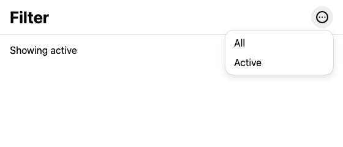

# Web: a checked `menuitemradio` shows no checkmark

A popover `role="menu"` with two `role="menuitemradio"` buttons, the selected one `aria-checked`. On
iOS the checked item has a checkmark: `host/apple/Sources/ExactKit/IOS/MenuItemsIOS.swift:74` sets
`action.state = .on` on a checked row, and UIMenu draws that as a checkmark. The web host draws both
items the same way:



Exact's guide says a menu row takes `aria-checked` for a checkmark (`docs/contract-for-agents.md`,
line 2933). `aria-checked` is set in the DOM and updates, so assistive technology is told; nothing draws it.

## Setup

Needs Bun 1.4.2 and an Exact checkout set up with `bun scripts/exact.mjs setup`. Clone this
repository beside the checkout, or set `EXACT2` to the checkout's absolute path:

```sh
git clone https://github.com/expo/exact
git clone REPO_URL exact-repro-web-menu-checkmark
cd exact-repro-web-menu-checkmark
```

## Run

```sh
./repro.sh
```

It exits 1 while the problem is present, 0 once it is fixed, and 2 when its setup fails.

The script opens the menu with All checked, then with Active checked, and compares the two
screenshots. Today the only difference is the "Showing …" label:

```
BUG: the menu looks the same with All or Active checked; only the label differs:
  1 [92,75 33×13] (175 px²) under showing (Text "Showing active") [0,57 420×50] app.contract:16
```

It exits 0 when the menu itself differs between the two, as it will once a mark moves from All to
Active. It does not check that the unchecked item's label stays aligned with the checked one's.

To try it by hand: `bun exact.mjs web`, open the URL it prints, pick an item, and reopen the menu.

Checked against Exact `c582b3b` on macOS 27.2.1, Xcode 27.2, Bun 1.4.2.
